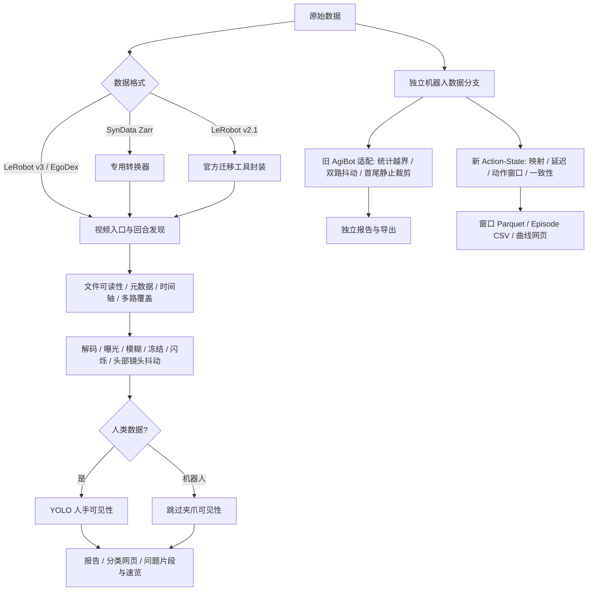

# Robot Data QC

机器人与人类操作数据的格式转换、视频质量检查、运动及动作—状态一致性质检脚本集合。源自 `/data_all/cenyj/scripts` 的当前实现快照，已整理为独立 Git 仓库。原脚本、数据与既有结果保持原位。

**推荐入口：`python pipeline.py`。** 各阶段可以独立执行，目前没有一键自动串联所有阶段，也没有把动作质检结果自动合并进视频报告。视频/动作一致性默认只报告；`robot-motion` 旧入口会另外导出 PASS 子集和首尾裁剪结果，使用前见下文。

## 管线结构



这表示逻辑顺序。实际执行会复用一次解码计算多项指标；部分文件异常直接终止该回合，其他候选问题继续汇总。并不是每个方框都单独读取一遍视频。

## 环境

新机器使用独立环境，不修改系统 Python：

```bash
python3 -m venv .venv
source .venv/bin/activate
pip install -r requirements/base.txt
python pipeline.py --help
```

还需系统 `ffmpeg`、`ffprobe`（视频导出/检查）。PyAV 所用的 FFmpeg 库需包含 `signalstats`、`freezedetect`，启用块检测时还需 `blockdetect`；命令行 FFmpeg 与 PyAV 绑定的库可能不同。视频默认 CPU 解码，不需要 CUDA。

人手检测另装 `requirements/hands.txt`，选择适配服务器的 CUDA PyTorch。自备手部专用 YOLO 权重，通过 `--weights` 指定；仓库不含权重，不会用通用 COCO 模型替代手部模型。转换另见 `requirements/conversion.txt`。GPU 解码实验依赖另见实验文档。

当前服务器可直接用已有独立环境，不需要重复安装：

```bash
PY=/data_all/cenyj/.venvs/agibot_gripper_qc/bin/python
$PY pipeline.py --help
```

`requirements/server-snapshot.txt` 是原服务器实际安装版本的记录，不是跨平台锁文件；原环境有系统 site-packages 继承。新环境安装说明只做了依赖整理，尚未执行一次完整的干净安装验证。

## 视频质检：推荐入口

在项目根目录执行，数据、输出均用绝对路径，避免切换目录后路径指向错误：

```bash
python pipeline.py video \
  --input /data_all/cenyj/datasets/hifi_umi \
  --output /data_all/cenyj/lerobotv3_output/hifi_umi_project_run \
  --cpu-workers 24
```

- 统一入口默认 `configs/video_fast.json`：4Hz 画质抽样、关闭压缩块检测，适合当前效率要求。视频仍完整解码做时间轴/帧间检查，并非只解码4帧/秒。
- 要启用持续大面积压缩块检测，添加 `--config configs/video_with_block.json`。关闭时依赖块分数的花屏确认分支也会跳过，不能算作检查通过。
- 脚本原入口 `scripts/video_quality_pipeline_v2.py` 保留原默认配置，与统一入口的 fast 默认不同。
- 限定实际运行5分钟加 `--time-budget-seconds 300`；到时停止派发并完成在途任务，墙钟会稍超预算。续跑加 `--resume`，阈值改变时建议用新输出目录。
- 人类 EgoDex 将输入改为 `/data_all/cenyj/datasets/egoDex`，另加 `--weights /data_all/cenyj/models/hand_presence/hand_yolov8n.pt --gpus 2,3`。GPU 编号应选择当前可用设备。
- 自动 LeRobot 发现目前主要验证于 HiFi-UMI；机器人其它相机命名/目录布局先小样本检查，不能视为所有 LeRobot 数据的通用适配器。

输出包括分类 `review.html`、每回合原因和指标、运行进度、问题 MP4/速览。详见 [算子与限制](docs/PIPELINE.md)、[原视频入口说明](scripts/README_video_quality_pipeline_v2.md)。

## 动作—状态一致性

```bash
python pipeline.py action \
  --input /data_all/cenyj/datasets/action/file-011.parquet \
  --info /data_all/cenyj/datasets/action/info.json \
  --config configs/action_state.json \
  --output /data_all/cenyj/lerobotv3_output/action_project_run
```

目前专用于已确认的绝对位置目标、弧度制。按 info.json 将左右臂/左右手58维映射，State 暂按实测值、同一行 timestamp 暂按共享时间基准；无法从字段名证明控制语义。输出 `episodes.csv`、`windows.parquet`、`xcorr.csv`、配置假设及8条诊断图网页。

**UNASSESSABLE 不等于不合格**。当前“相关峰差至少0.02”规则较严格，尚未实现宽峰延迟区间复核；阈值需用人工确认的正常样本校准。详见 [动作说明](scripts/README_action_state_qc.md)、[当前实测](docs/BENCHMARKS.md)。

## 其他入口

| 命令 | 作用与边界 |
|---|---|
| `convert-syndata` | 指定 SynData Zarr 布局转换；保持状态，不编造 action；默认10fps |
| `migrate-v21` | 官方 LeRobot v2.1 → v3 迁移工具封装 |
| `robot-motion` | 旧 AgiBot 专用运动/画质检查、双路抖动和首尾裁剪；默认抽10条，导出 PASS 子集 |
| `summary` | 汇总视频运行速度、状态和时间分解 |
| `pass-samples` | 从通过回合中抽样导出视频，辅助查漏检 |
| `image` | 用相同基础画质算子检查单张图片 |

`python pipeline.py <命令> --help` 查看实际参数。格式转换不能自动补回输入没有的字段。旧运动入口的阈值、抽样频率不同于视频 v2，不要将两者当作同一套配置。详细脚本索引见 [脚本清单](docs/SCRIPT_INDEX.md)。

## 打开报告网页

服务器：

```bash
cd /data_all/cenyj/lerobotv3_output/action_project_run
python3 -m http.server 9966 --bind 127.0.0.1
```

本地电脑终端：

```bash
ssh -N -L 9966:127.0.0.1:9966 用户名@服务器地址
```

浏览器打开 `http://127.0.0.1:9966/review.html`。视频报告要通过 HTTP 服务打开，以便页面读取 JSON/CSV；确认服务目录是本次输出目录。

## 维护约定

- 项目内脚本是独立副本，后续改这里并提交 Git；旧 `/data_all/cenyj/scripts` 不会自动同步。
- 数据、模型、视频、Parquet、运行数据库和环境不进 Git。
- `scripts/README_*` 保留历史运行说明，可能提到原服务器路径；以本 README 的新项目入口为准。
- GPU 像素算子实验尚未稳定，不能替换默认流程；[实验状态](docs/EXPERIMENTS.md)。
- 本次只建立本地 Git 仓库，没有配置或推送远端。未擅自为项目添加开源许可证；发布时需确定许可并核对第三方模型许可。
